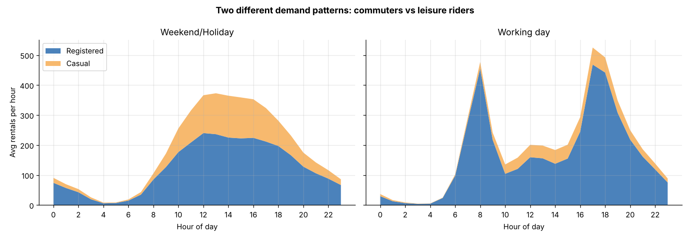
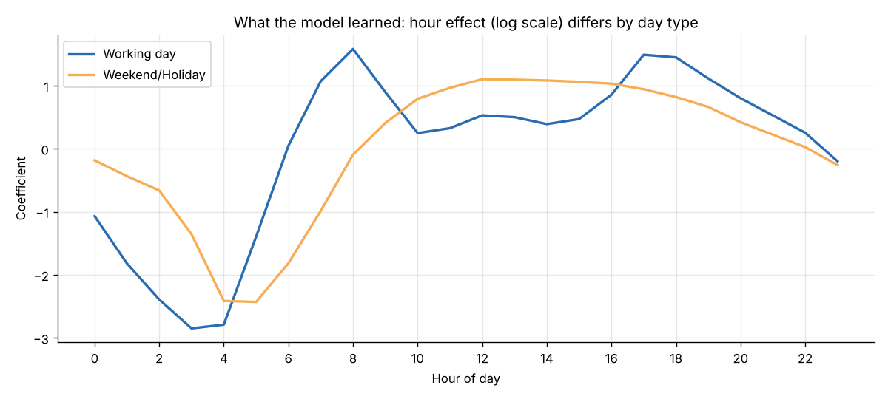
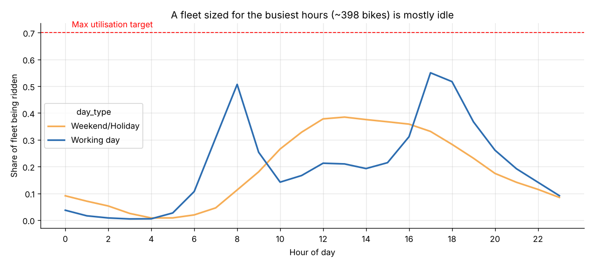

# Bike Sharing Case Study: Should we just buy more bikes?

**Short answer: .** Riders can't find bikes because of *when and where* the bikes are, not how many there are. Commuters empty residential stations and fill downtown docks every working-day morning, then reverse it in the evening. Rebalancing around those peaks should fix most complaints. Buying bikes makes sense only to keep up with growth (+65% in one year).

**Live report:** https://github.com/ishitaag1/sigmoid_bike_sharing

---

## Files

| File | What it is |
|---|---|
| `analysis.ipynb` | Full analysis with outputs: quality checks, features, exploration, hypothesis test, model, fleet sizing, recommendation |
| `index.html` | The same report as a web page, without code (used for the live site) |
| `model_utils.py` | Data cleaning, the model, and the bikes-needed formula |
| `demand_assistant.py` | Prototype: ask demand questions in plain English |
| `figures/` | Charts |
| `hour.csv`, `day.csv` | Dataset |

```bash
pip install -r requirements.txt
jupyter notebook analysis.ipynb     # the analysis
python demand_assistant.py          # the assistant
```

---

## 1. Data quality checks

No nulls or duplicates, `casual + registered = cnt` on every row, and hourly totals match `day.csv`. Issues found:

| Issue | Decision |
|---|---|
| 165 missing hours: mostly 1–5 AM, plus **Hurricane Sandy (29–30 Oct 2012)** and a **Jan 2011 snowstorm** | Kept. These are real events, and night hours don't affect peak sizing |
| Humidity = 0 all day on 2011-03-10 | Sensor error, replaced with the March 2011 median |
| Weather type 4 appears only 3 times | Merged into type 3 |
| 12.5% of hours have windspeed = 0 | Possibly missing values, flagged |
| `temp` and `atemp` are 0.99 correlated | Model uses `temp` only |
| `casual` / `registered` add up to the target | Not used as features (leakage) |

## 2. Features

- **Hour and day type drive everything.** Working days have two commute peaks (8 AM, 5–6 PM) from registered users. Weekends have one midday hump with many casual riders.
- **Growth:** 2012 is 65% busier than 2011.
- **Season, temperature and weather:** summer is 2–3x winter, and rain halves demand.
- **Engineered feature `hr_day` (hour × day type):** the effect of the hour *depends on* the day type. 8 AM is the busiest hour on a working day and a quiet one on a weekend.
- `workingday` has ~0 correlation with rentals (0.03) but completely changes the daily shape. Its effect only shows up through the interaction.



## 3. Hypothesis

**H1: the shortage is a timing problem, not a fleet-size problem.** On working days, peak-hour rentals (7–9 AM, 4–7 PM) are higher than off-peak daytime (10 AM–3 PM).

- **Test:** one-sided Mann–Whitney U (counts are skewed) plus the effect size.
- **Result:** the median peak hour has **~2x** the rentals of the median off-peak hour, p ≈ 0. H0 rejected.
- **Control:** on weekends the ratio flips to 0.5x, so the spike comes from commuting.
- **Concentration:** 7 peak hours carry **58%** of working-day rentals.

**Real-world test (pilot):**
- Randomly assign ~20 station clusters to rebalancing vs business as usual for 4–6 weeks.
- Rebalancing means: fill residential before 7 AM, clear full downtown docks mid-morning, keep enough bikes downtown for 5 PM.
- Primary metric: minutes stations sit empty or full during peaks.
- Guardrail: rebalancing cost per extra ride.

## 4. Demand model

- **Target:** `log(rentals + 1)` per hour.
- **Time-based split:** train Jan 2011–Aug 2012, test Sep–Dec 2012.

| Model | MAE | RMSE | R² | MAE (peak hours) |
|---|---|---|---|---|
| Baseline: historical avg by hour/day type/year | 74.5 | 114.2 | 0.725 | 126.2 |
| Linear regression | 78.8 | 116.8 | 0.712 | 138.6 |
| **Linear regression + hour × day type (chosen)** | **44.0** | **70.7** | **0.895** | **74.7** |
| Random forest | 50.7 | 77.3 | 0.874 | 87.3 |

**The interaction makes the difference.** Without it, linear regression is worse than the baseline, because it forces one daily shape onto every day. With it, the error drops by almost half and it **beats the random forest** on every metric. It's also the easiest model to explain and needs no tuning.

**Planning number:** in 90% of training hours, actual demand was below prediction × 1.5. On the test months that held for 95% of hours (slightly conservative, which is the safe side).



## 5. How many bikes are needed?

**Little's Law:** bikes on the road = rentals per hour × average trip length.
**Bikes needed = bikes on the road ÷ 70% max utilisation** (so some bikes stay docked and findable).

- A typical 2012 working-day peak hour (~630 rentals) needs **~300 bikes** (~450 using the conservative planning number).
- The busiest 1% of hours (~835 rentals) need **~400 bikes**.

| Busiest hours | 60% util | 70% util | 80% util |
|---|---|---|---|
| 15-min trips | 350 | 300 | 260 |
| 20-min trips | 460 | 400 | 350 |
| 30-min trips | 700 | 600 | 520 |

**Key finding:** a fleet sized for the busiest hours is **more than half idle in 93% of hours**, and only **~20% in use on average**. Riders are short of bikes *at their station at 8 AM*, not in the city.



## 6. Prototype: plain-English questions

```
You: Will 300 bikes be enough at 6pm on Friday in July?

[Friday, July, clear]
At 18:00 expect ~758 rentals (plan for up to 1137). Keep ~541 bikes available.
300 bikes is probably NOT enough system-wide (they still need to be at the right stations).
Tip: fill residential stations before 7 AM, clear full downtown docks mid-morning,
and keep enough bikes downtown for the 5 PM rush.
Assumed: clear weather (typical temperature for the month).
```

- Keywords in the question (hour, day, month, weather, fleet size) set the inputs to the model.
- Anything missing gets a default, and the answer says which defaults it used.
- The numbers always come from the model. An LLM could later replace the keyword matching, turning the question into the same inputs, while the model still produces the numbers.

## 7. Recommendation

1. **Don't buy bikes yet.** Fix distribution first.
2. **Rebalance around the commute:** fill residential stations before 7 AM, clear full downtown docks mid-morning so arriving commuters can park, and keep enough bikes downtown for the 5 PM rush. On weekends, stock parks and leisure spots early.
3. **Plan trucks and staff from the forecast**, using tomorrow's weather.
4. **Run the pilot** before committing money.
5. **Buy for growth, not peaks** (~65% yearly growth).
6. **Collect station-level data:** dock status, failed unlocks and trip durations.

## Assumptions and limitations

- 20-minute average trip and 70% max utilisation (see the sensitivity table).
- No station data, so "where" is inferred from commuter patterns.
- The model uses actual weather. In production it would use forecasts.
- `yr` is a 2011/2012 switch, so future growth needs a separate adjustment.

*Dataset: Fanaee-T, H. and Gama, J., "Event labeling combining ensemble detectors and background knowledge", Progress in Artificial Intelligence (2013). doi:10.1007/s13748-013-0040-3*
